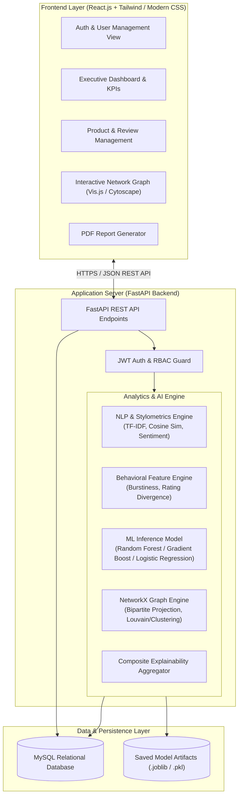
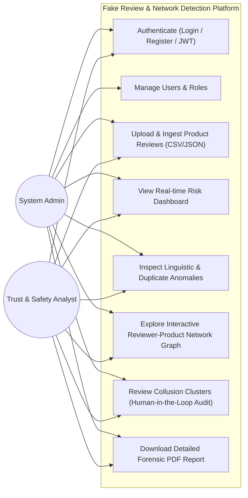
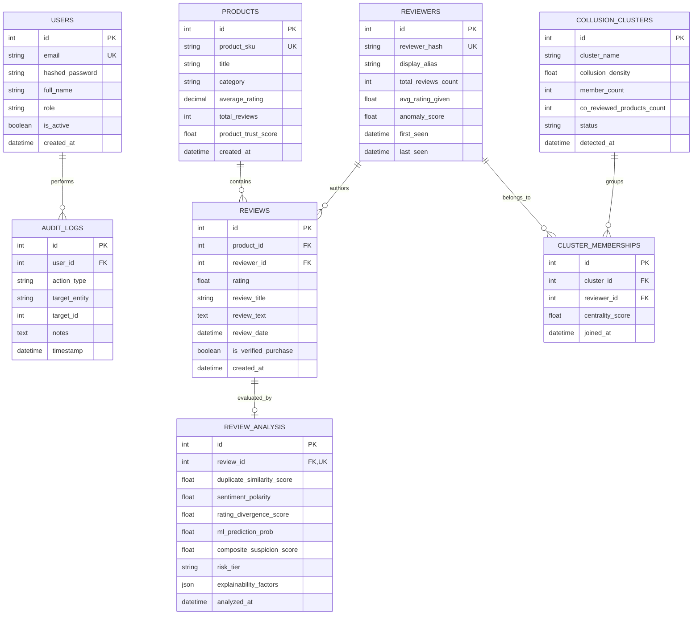

# Phase 1: Software Requirements Specification & System Architecture
## AI-Powered Fake Review & Coordinated Reviewer Network Detection System

---

## 1. Executive Summary & Problem Formulation

### 1.1 Problem Statement
Modern e-commerce ecosystems suffer from sophisticated opinion fraud. Traditional detection mechanisms typically evaluate reviews in isolation (analyzing sentiment polarity, lexical spam patterns, or rating outliers). However, modern fraudulent actors operate using **coordinated reviewer networks** (collusion rings, mercenary review farms, and Sybil accounts) that coordinate across products and timestamps to bypass univariate spam filters. 

### 1.2 System Objective
To build an enterprise-grade, human-in-the-loop web platform that combines:
1. **Content-level NLP & Stylometrics**: Catching duplicate text, anomalous sentiment, and linguistic deception.
2. **Behavioral Heuristics**: Detecting burst posting, rating divergence from product norms, and velocity spikes.
3. **Graph Theory & Bipartite Network Analysis**: Uncovering latent reviewer-product collusion graphs and dense bipartite cliques using **NetworkX**.
4. **Explainable AI (XAI)**: Breaking down risk scores into transparent risk factors rather than black-box verdicts.
5. **Privacy by Design**: Ensuring reviewer personal identities are pseudonymized and ethical guidelines are strictly enforced.

---

## 2. Software Requirements Specification (SRS)

### 2.1 Functional Requirements (FR)

| ID | Module | Requirement Description |
|:---|:---|:---|
| **FR-01** | **Authentication & RBAC** | JWT-based auth supporting roles: `Admin` (full audit control, user management) and `Analyst` (investigate flagged clusters, generate reports). Password hashing with bcrypt. |
| **FR-02** | **Product Management** | Create, view, update, and search products. Track metadata (category, launch date, average rating, baseline review count). |
| **FR-03** | **Review Ingestion** | Batch upload (CSV/JSON) and single-review ingestion with automated field validation and sanitization. |
| **FR-04** | **Linguistic & Duplicate Analysis** | Compute TF-IDF vector cosine similarity across reviews to catch copy-pasted or template-spun reviews. Extract stylometric metrics (punctuation density, lexical diversity, capital letter ratios). |
| **FR-05** | **Sentiment & Rating Divergence** | Measure divergence between textual sentiment polarity (e.g. negative tone) and star rating (e.g. 5 stars), flagging cognitive dissonance anomalies. |
| **FR-06** | **Behavioral Modeling** | Calculate review velocity (burst reviews within time windows), product co-review frequencies, and extreme rating biases (1-star or 5-star skew). |
| **FR-07** | **Bipartite Graph & Network Analysis** | Construct a bipartite graph $G = (U, V, E)$ where $U$ = Reviewers, $V$ = Products, and $E$ = Reviews. Project into a Reviewer-Reviewer co-review graph. Detect connected components, high-degree clusters, and maximal cliques using NetworkX. |
| **FR-08** | **Hybrid Suspicious Scoring (XAI)** | Compute a composite Suspicion Score $S \in [0, 100]$ composed of Weighted NLP Spam Score, Behavioral Score, and Network Centrality/Co-review Score. Return individual component contributions for explainability. |
| **FR-09** | **Interactive Visualization** | Interactive React-based 2D force-directed graph (Cytoscape / VisNetwork / D3 / Canvas) displaying reviewer-product nodes, cluster communities, and edge weights. |
| **FR-10** | **Audit & Human-in-the-Loop** | Allow analysts to confirm, dismiss, or add investigation notes to flagged reviews/clusters without changing automated ground truth. |
| **FR-11** | **Reporting Engine** | Export comprehensive PDF audit dossiers containing network topology summaries, top suspicious clusters, product risk scores, and recommended actions. |

### 2.2 Non-Functional Requirements (NFR)

- **Security & Privacy**:
  - Reviewer identifiers (usernames, email addresses, IP addresses) must be salted and SHA-256 hashed before ingestion to protect reviewer privacy.
  - Role-Based Access Control (RBAC) enforced on all FastAPI endpoints.
  - SQL injection prevention via SQLAlchemy ORM parameterized queries.
  - Cross-Origin Resource Sharing (CORS) configured strictly for the trusted React frontend.
- **Explainability & Ethical AI**:
  - No customer shall be labeled with legally defamatory words like "criminal" or "fraudster". The platform labels behavior as "High Anomaly Indicator", "Coordinated Cluster Member", or "High Risk of Promotional Manipulation".
  - Clear explanations (e.g., *"+35% weight: 94% text similarity to 12 other reviews; +40% weight: Co-reviewed 8 identical products within 2 hours with User_X"*).
- **Performance & Scalability**:
  - API response time $< 200\text{ ms}$ for standard CRUD operations.
  - Graph construction and clustering for up to 10,000 nodes $< 3.5\text{ seconds}$.
- **Data Integrity**:
  - Database enforced foreign keys, unique constraints on review duplicates, and transactional atomic writes.

---

## 3. System Architecture

The system follows a modern decoupled **Client-Server 3-Tier Architecture** with a specialized **ML & Graph Processing Pipeline**:

---

## 4. Use Case Analysis

---

## 5. Database Schema (Entity-Relationship Design)

---

## 6. End-to-End Implementation Roadmap

| Phase | Title | Core Objective | Key Deliverables |
|:---:|:---|:---|:---|
| **Phase 1** | **System Specifications & Architecture** | Foundations, SRS, Schema, and Design. | SRS, Architecture diagram, ER diagram, Roadmap. |
| **Phase 2** | **Project Setup & Database Initializer** | Virtual environment, MySQL setup, and ORM models. | FastAPI project scaffold, SQLAlchemy models, migration scripts. |
| **Phase 3** | **Backend Foundation (FastAPI)** | Core API, Auth with JWT, and CRUD routes. | `/api/v1/auth`, `/api/v1/products`, `/api/v1/reviews`. |
| **Phase 4** | **Data Collection & Preprocessing** | Public dataset loading, cleaning, PII hashing. | Preprocessing scripts, data validator, standard benchmark dataset. |
| **Phase 5** | **NLP & Stylometric Feature Pipeline** | Text cleaning, TF-IDF, duplicate detection, sentiment. | NLP pipeline module with cosine similarity & sentiment divergence. |
| **Phase 6** | **Machine Learning Classification Engine** | Train & evaluate ML models (Logistic Regression, Random Forest, etc.). | Model training pipeline, metrics comparison (AUC, F1, Recall), model persistence. |
| **Phase 7** | **Graph Network & Collusion Mining** | Bipartite reviewer-product graph modeling with NetworkX. | Bipartite graph engine, clique/community detection, graph export API. |
| **Phase 8** | **Frontend Development (React.js)** | Modern UI: Auth, Upload, Dashboard, Graph Visualizer. | React dashboard, product inspection views, interactive 2D graph viewer. |
| **Phase 9** | **Integration, XAI & PDF Reporting** | Connect Frontend & Backend, explainable score breakdown, PDF exports. | End-to-end integration, ReportLab/WeasyPrint automated PDF reports. |
| **Phase 10**| **Security Hardening, Testing & Deployment** | Unit/integration testing, Docker containerization, docs. | Pytest suite, Docker Compose setup, user manual. |
